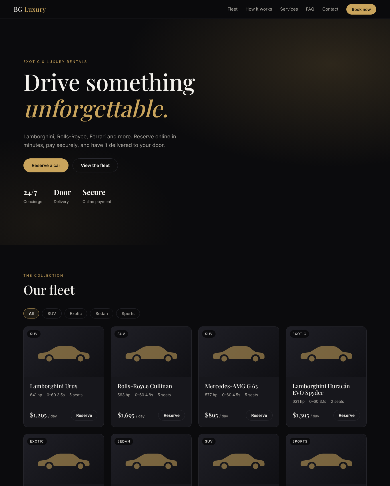

# BG Luxury Cars: refreshed site

A redesigned luxury car rental website with:

- **Online booking form**: pick a car and dates, see a live quote, then pay a deposit or the full amount.
- **Secure payments via Stripe Checkout**: card details go straight to Stripe and never touch this server. Prices are calculated on the server from `data/fleet.js`, so a customer can't change the amount in their browser.
- **Contact / inquiry form** for chauffeur quotes, events and general questions.
- Filterable fleet, how it works, services, FAQ/requirements, and a layout that works on phones.



## Run it locally

```bash
cd bg-luxury
npm install
cp .env.example .env   # optional, see below
npm start              # http://localhost:3000
```

Without a Stripe key the site runs in **demo mode**: bookings are saved but no card is charged, and the confirmation page says so.

## Turn on real payments

1. Create a [Stripe](https://dashboard.stripe.com/register) account and copy the **secret key** (`sk_test_...` while testing) into `STRIPE_SECRET_KEY` in `.env`.
2. Set `SITE_URL` to the public address of the site (Stripe returns customers there after paying).
3. Add a webhook in the Stripe Dashboard pointing to `https://YOUR-SITE/api/stripe/webhook` with the `checkout.session.completed` event, and put its signing secret in `STRIPE_WEBHOOK_SECRET`. This is what marks a booking as `paid`.
   For local testing: `stripe listen --forward-to localhost:3000/api/stripe/webhook`.
4. Use Stripe's test card `4242 4242 4242 4242` to try it, then switch to the live key when ready.

Adjust `DEPOSIT_PERCENT`, `SECURITY_DEPOSIT` and `CURRENCY` in `.env` as needed.

## Customize the content

Everything business-specific is placeholder content. Replace it with the real details before going live:

| What | Where |
| --- | --- |
| Cars, daily rates, specs, photos (`image` URL) | `data/fleet.js` |
| Phone, email, hours, location | Contact section in `public/index.html` |
| Policies (age, insurance, cancellation, mileage) | FAQ section in `public/index.html` |
| Colors and fonts | Variables at the top of `public/styles.css` |

## Where submissions go

Bookings and messages are saved to `data/bookings.json` and `data/inquiries.json` (not committed to git). That's fine for a demo. For production, connect `data/store.js` to a database, or forward submissions to email/a CRM. Many hosts (Render, Railway, Fly.io) wipe the local disk on redeploy.

## Hosting

This is a small Node.js (18+) app. It needs a host that runs a server (Render, Railway, Fly.io, a VPS). It won't work on GitHub Pages, which only serves static files.
